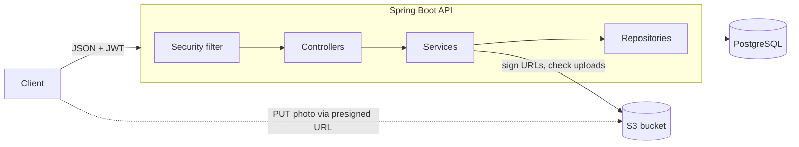

# LeaseLedger

A rent and property management backend. Property managers list their buildings and units, sign tenants onto leases, and track what has been paid. Tenants see what they owe and report maintenance problems with photos.

I built it around how renting works in the UAE, where a year's rent is agreed up front and usually paid in one to twelve post-dated cheques. Somebody has to work out the schedule, know which payments have cleared, and chase the ones that haven't. That is the job this does.

**Status:** work in progress. The backend API below is built and tested. The React frontend, the reminder worker and the AWS deployment are not done yet; see [Roadmap](#roadmap).

## What works today

- Sign up and log in as a manager or tenant (JWT, role-based access)
- Managers create properties and units, and see occupancy counts per property
- Creating a lease generates the full payment schedule as invoices, plus a deposit invoice
- Record payments, filter invoices by pending / overdue / paid, end a lease early
- Tenants raise maintenance requests; managers move them through open → in progress → resolved
- Photos upload straight from the client to S3 using presigned URLs

## Parts I'd point a reviewer at

**Two people leasing the same unit at once.** "Check the unit is vacant, then create the lease" is a race. [`LeaseConcurrencyTest`](backend/src/test/java/com/leaseledger/lease/LeaseConcurrencyTest.java) fires 8 requests for one unit from 8 threads and expects exactly one to win. Without the row lock in [`UnitRepository`](backend/src/main/java/com/leaseledger/property/UnitRepository.java) all 8 succeed. I checked that by deleting the lock and watching the test fail.

**Splitting rent without losing a fil.** AED 100,000 in 6 instalments is 16,666.666… each. Round each one to the nearest fil and the tenant gets billed 100,000.02. [`RentSchedule`](backend/src/main/java/com/leaseledger/lease/RentSchedule.java) rounds down and puts the remainder on the last instalment, so the invoices always add up to the contract. It also keeps a lease that starts on the 31st from drifting to the 28th after February.

**Uploads that don't go through the API.** The server signs a short-lived URL for one specific object key and the client PUTs the file to S3 itself. The server then asks S3 whether the file really exists and how big it is before saving anything, because "I uploaded it" from a client isn't evidence. See [`MaintenancePhotoService`](backend/src/main/java/com/leaseledger/maintenance/MaintenancePhotoService.java).

**Manager A can't read manager B's data.** A role check isn't enough when two users share a role. Every lookup includes the owner in the query itself, and someone else's record returns 404, not 403, so ids can't be probed.

**What broke on real PostgreSQL.** The tests were green on in-memory H2. The first run against PostgreSQL in Docker couldn't even connect: the driver sends the JVM's time zone name, Windows calls India `Asia/Calcutta`, and PostgreSQL 16 rejects that legacy name. The app now runs in UTC and keeps a separate, configured clock for business dates. Details in [docs/04](docs/04-maintenance-and-file-uploads.md).

## Architecture



One deployable service, split into feature packages (`auth`, `user`, `property`, `lease`, `maintenance`, `storage`). I chose that over microservices deliberately: creating a lease has to update the unit and write a dozen invoices atomically, which is one database transaction here and a saga anywhere else. The piece that genuinely benefits from being separate, sending reminders, will be a queue consumer.

## Stack

| | |
|---|---|
| Language / framework | Java 17, Spring Boot 3.4, Spring Security, Spring Data JPA |
| Database | PostgreSQL 16, schema managed with Flyway |
| Storage | AWS S3 (SDK v2), LocalStack for local development |
| Tests | JUnit 5, MockMvc, Testcontainers |
| Tooling | Maven, Docker Compose |

## Running it

You need Java 17 and Maven. Docker is optional for a first look.

**Fastest, no Docker.** In-memory database; everything works except photo upload.

```bash
cd backend
mvn spring-boot:run -Dspring-boot.run.profiles=local
```

**With PostgreSQL and a local S3.**

```bash
docker compose up -d
```

Then start the app without a profile, with these set:

| Variable | Value |
|---|---|
| `LEASELEDGER_JWT_SECRET` | Base64 string of at least 32 bytes (`openssl rand -base64 32`) |
| `LEASELEDGER_S3_ENDPOINT` | `http://localhost:4566` |

**Against a real S3 bucket.** Leave `LEASELEDGER_S3_ENDPOINT` unset, set `LEASELEDGER_S3_BUCKET` and `AWS_REGION`, and have AWS credentials available the usual way (`aws configure`, or an instance role). No keys go in this repo.

A first request:

```bash
curl -X POST localhost:8080/api/auth/register -H "Content-Type: application/json" \
  -d '{"email":"manager@example.com","password":"correct-horse","fullName":"Demo Manager","role":"MANAGER"}'
```

Send the returned `accessToken` as `Authorization: Bearer <token>` on everything else.

## API

| Area | Endpoints |
|---|---|
| Auth | `POST /api/auth/register`, `POST /api/auth/login`, `GET /api/users/me` |
| Properties | `GET, POST /api/properties`, `GET, PUT, DELETE /api/properties/{id}` |
| Units | `GET, POST /api/properties/{id}/units`, `PUT, DELETE /api/properties/{id}/units/{unitId}` |
| Leases | `GET, POST /api/leases`, `GET /api/leases/{id}`, `POST /api/leases/{id}/terminate` |
| Invoices | `GET /api/invoices?filter=OVERDUE`, `POST /api/invoices/{id}/mark-paid` |
| Maintenance | `GET, POST /api/maintenance-requests`, `GET /api/maintenance-requests/{id}`, `POST .../{id}/status` |
| Photos | `POST .../{id}/photos/upload-url`, `POST .../{id}/photos` |

Errors come back as RFC 9457 problem details. Lists are paginated with `page` and `size`.

## Tests

```bash
cd backend
mvn test
```

56 tests. Most drive the whole application over HTTP against an in-memory database. The S3 test starts LocalStack in Docker through Testcontainers and is skipped if Docker isn't running. To run the suite against the PostgreSQL container instead:

```bash
mvn test -Dspring.datasource.url=jdbc:postgresql://localhost:5432/leaseledger \
  -Dspring.datasource.username=leaseledger -Dspring.datasource.password=leaseledger
```

## Roadmap

- [x] Users, roles, JWT login
- [x] Properties and units
- [x] Leases, rent schedules, invoices
- [x] Maintenance requests with photo upload
- [ ] Rent reminders through SQS and a worker; closing leases that reach their end date
- [ ] React app: manager dashboard and tenant portal
- [ ] CI pipeline and AWS deployment (EC2, RDS)
- [ ] Card payments for invoices

## Known gaps

Things I know are missing or simplified, so nobody has to find them the hard way:

- No refresh tokens or logout; access tokens live for 60 minutes.
- Anyone can register as a manager. A real product would invite or approve them.
- Payments are recorded by hand. No partial payments, no reversing a mistake.
- A lease past its end date isn't closed automatically yet, so the unit stays occupied.
- Uploaded files are trusted to be the type they claim; the bytes aren't inspected.
- S3 behaviour is tested against LocalStack, which doesn't enforce bucket access rules.

## Design notes

Longer write-ups of the decisions in each part, including the trade-offs:

1. [Foundation and authentication](docs/01-foundation-and-auth.md)
2. [Properties and units](docs/02-properties-and-units.md)
3. [Leases and invoices](docs/03-leases-and-invoices.md)
4. [Maintenance and file uploads](docs/04-maintenance-and-file-uploads.md)
